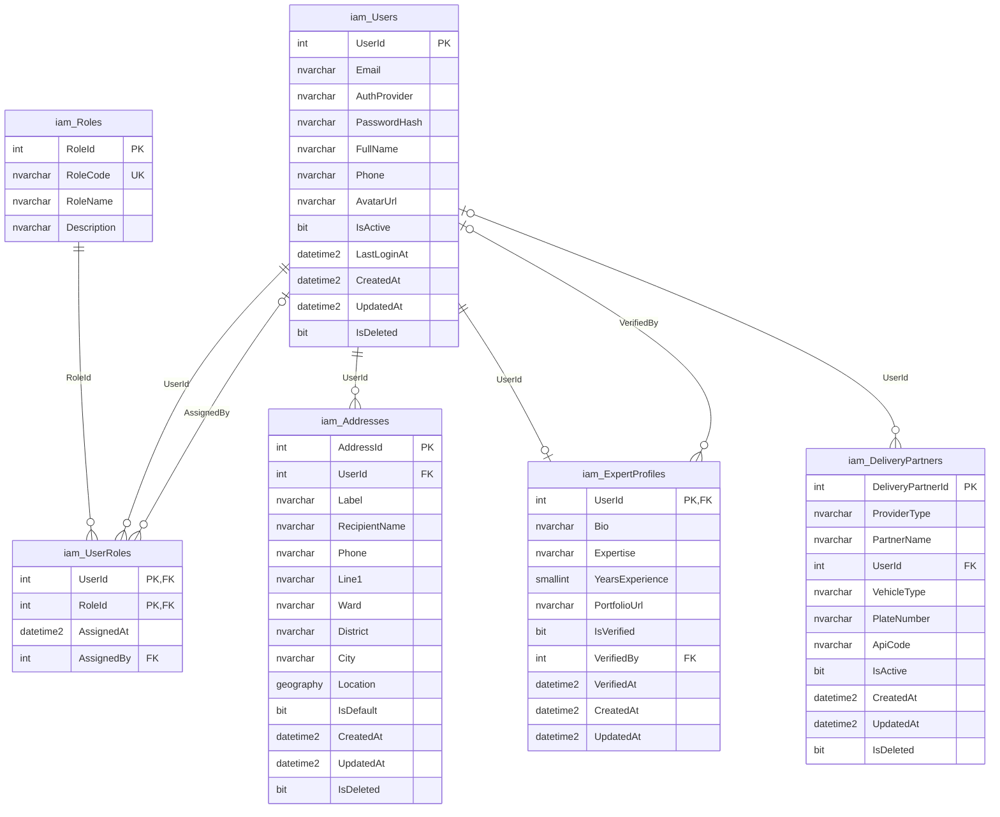
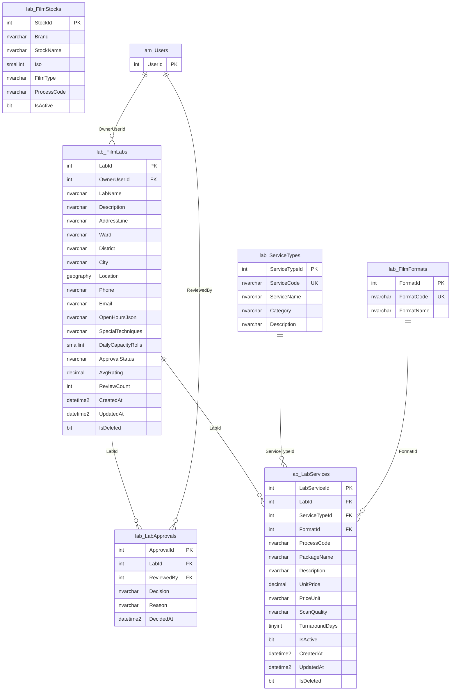
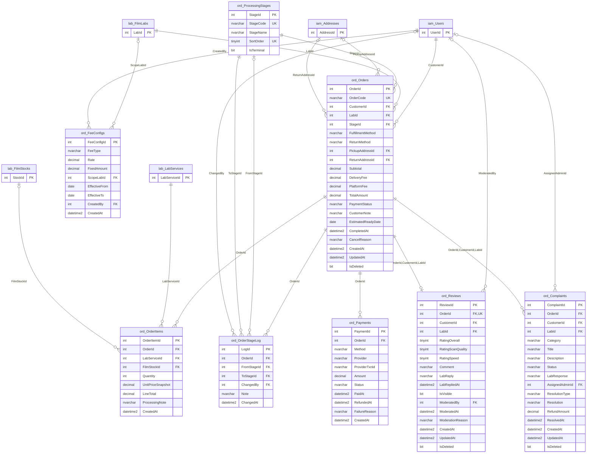
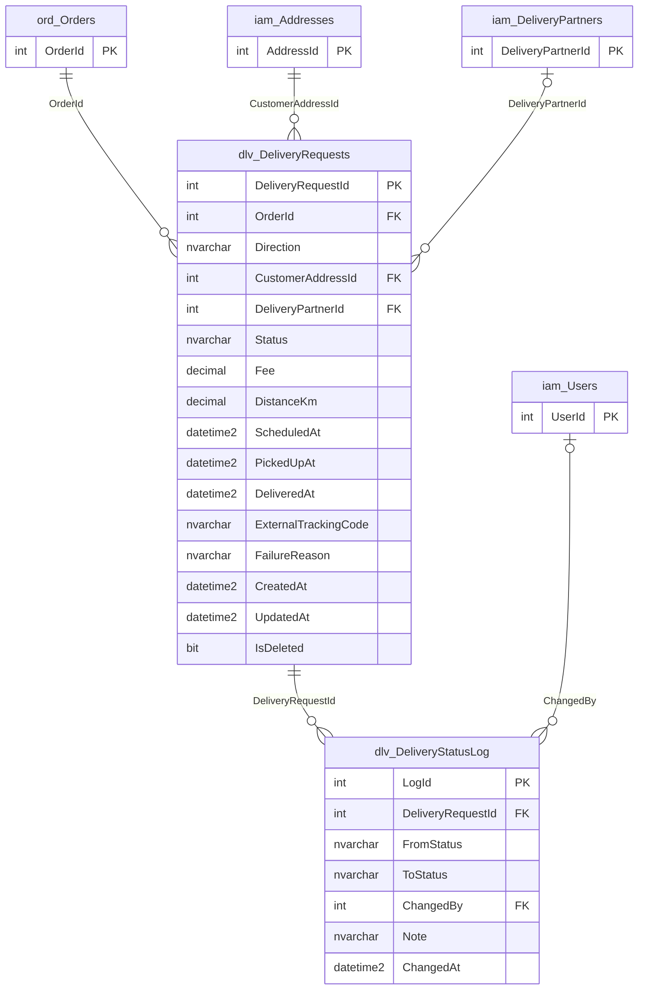
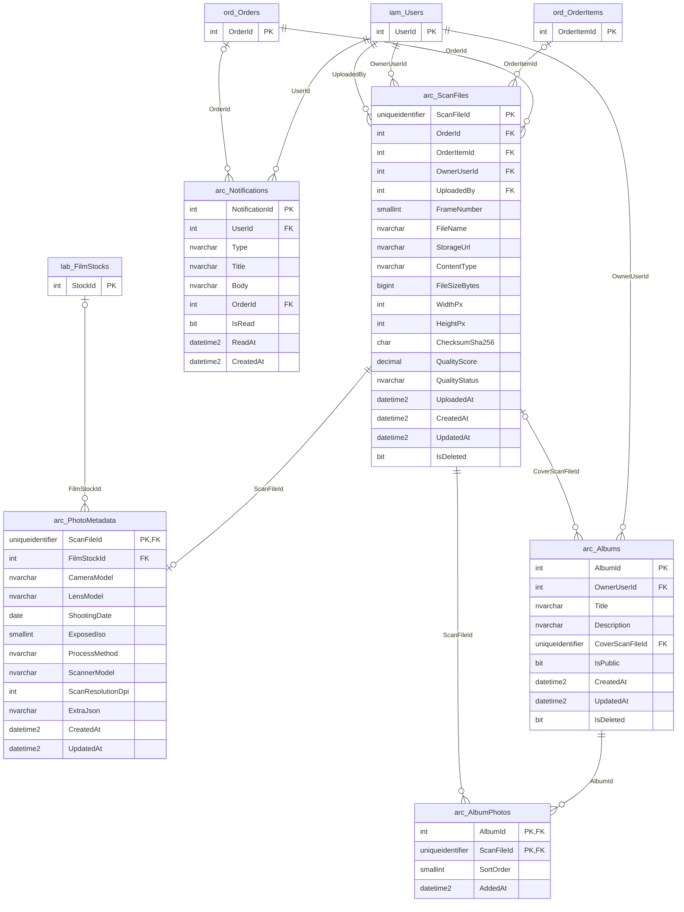
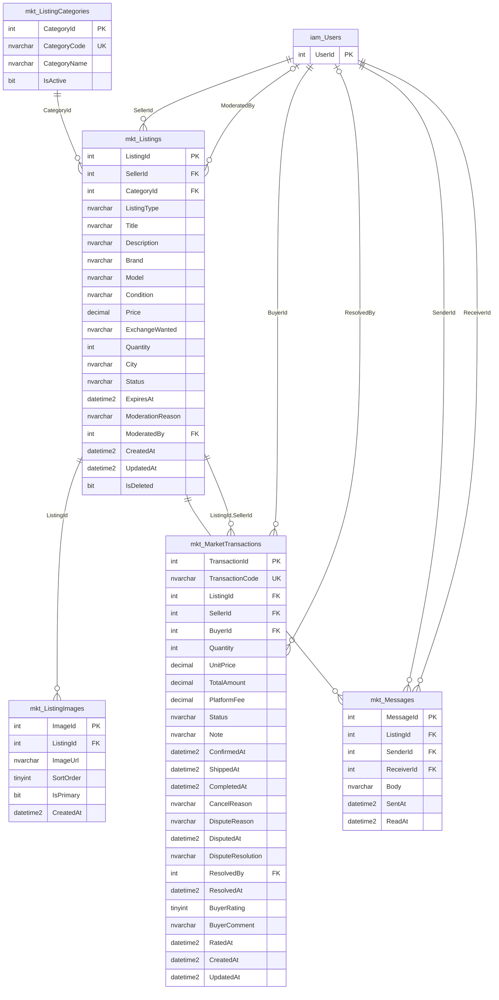
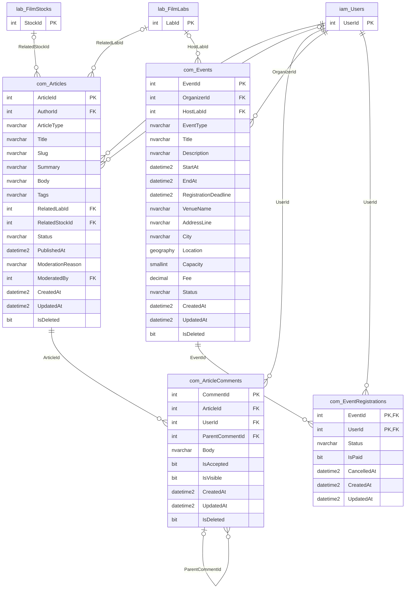
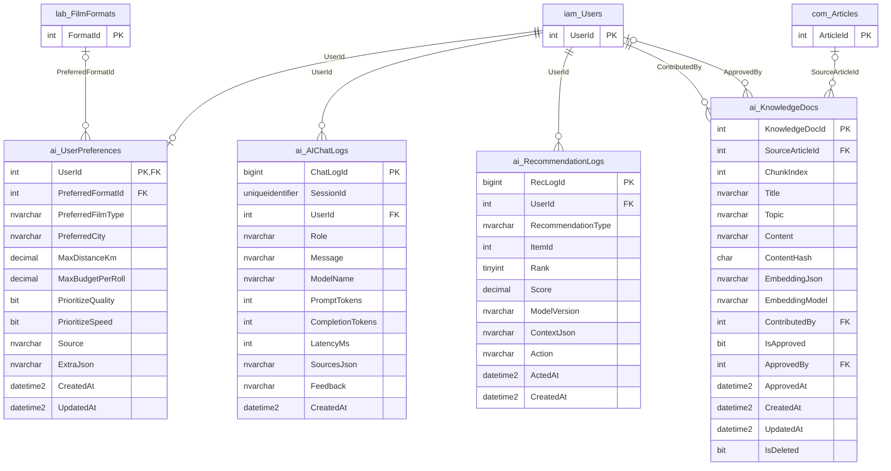
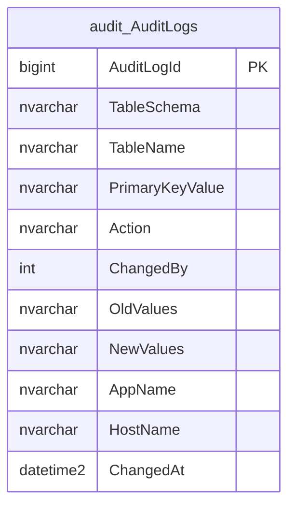

# ERD: FilmLabDB (41 bảng)

> **File này được sinh tự động** từ `tools/schema_spec.py` bằng `python tools/gen_erd.py`. Không sửa tay; muốn đổi thiết kế thì sửa `schema_spec.py` rồi chạy lại.

**Cách xem:** GitHub hiển thị sơ đồ Mermaid ngay trong trang này. Để chỉnh sửa/xuất ảnh: dán khối code vào <https://mermaid.live> hoặc draw.io (*Arrange > Insert > Advanced > Mermaid*).

**Quy ước ký hiệu:**

| Ký hiệu | Nghĩa |
|---|---|
| `PK` / `FK` / `UK` | Khóa chính / khóa ngoại / duy nhất |
| `\|\|--o{` | Cha bắt buộc (1) - con có nhiều (0..N) |
| `\|o--o{` | Cha tùy chọn (0..1) - con có nhiều (0..N), cột FK cho phép NULL |
| `\|\|--o\|` | Quan hệ 1-1 (FK đồng thời là khóa chính hoặc unique) |
| Tên thực thể `iam_Users` | Schema `iam`, bảng `Users` |

Một số FK ghép (nhiều cột) được vẽ bằng một đường nối, nhãn là danh sách cột (ví dụ `OrderId,CustomerId,LabId`).

## 1. Tổng quan quan hệ giữa các bảng (không hiển thị cột)

```mermaid
erDiagram
    iam_Users ||--o{ iam_UserRoles : "UserId"
    iam_Roles ||--o{ iam_UserRoles : "RoleId"
    iam_Users |o--o{ iam_UserRoles : "AssignedBy"
    iam_Users ||--o{ iam_Addresses : "UserId"
    iam_Users ||--o| iam_ExpertProfiles : "UserId"
    iam_Users |o--o{ iam_ExpertProfiles : "VerifiedBy"
    iam_Users |o--o{ iam_DeliveryPartners : "UserId"
    iam_Users ||--o{ lab_FilmLabs : "OwnerUserId"
    lab_FilmLabs ||--o{ lab_LabApprovals : "LabId"
    iam_Users ||--o{ lab_LabApprovals : "ReviewedBy"
    lab_FilmLabs ||--o{ lab_LabServices : "LabId"
    lab_ServiceTypes ||--o{ lab_LabServices : "ServiceTypeId"
    lab_FilmFormats ||--o{ lab_LabServices : "FormatId"
    iam_Users ||--o{ ord_Orders : "CustomerId"
    lab_FilmLabs ||--o{ ord_Orders : "LabId"
    ord_ProcessingStages ||--o{ ord_Orders : "StageId"
    iam_Addresses |o--o{ ord_Orders : "PickupAddressId"
    iam_Addresses |o--o{ ord_Orders : "ReturnAddressId"
    ord_Orders ||--o{ ord_OrderItems : "OrderId"
    lab_LabServices ||--o{ ord_OrderItems : "LabServiceId"
    lab_FilmStocks |o--o{ ord_OrderItems : "FilmStockId"
    ord_Orders ||--o{ ord_OrderStageLog : "OrderId"
    ord_ProcessingStages |o--o{ ord_OrderStageLog : "FromStageId"
    ord_ProcessingStages ||--o{ ord_OrderStageLog : "ToStageId"
    iam_Users |o--o{ ord_OrderStageLog : "ChangedBy"
    ord_Orders ||--o{ ord_Payments : "OrderId"
    lab_FilmLabs |o--o{ ord_FeeConfigs : "ScopeLabId"
    iam_Users ||--o{ ord_FeeConfigs : "CreatedBy"
    iam_Users |o--o{ ord_Reviews : "ModeratedBy"
    iam_Users |o--o{ ord_Complaints : "AssignedAdminId"
    ord_Orders ||--o| ord_Reviews : "OrderId,CustomerId,LabId"
    ord_Orders ||--o{ ord_Complaints : "OrderId,CustomerId,LabId"
    ord_Orders ||--o{ dlv_DeliveryRequests : "OrderId"
    iam_Addresses ||--o{ dlv_DeliveryRequests : "CustomerAddressId"
    iam_DeliveryPartners |o--o{ dlv_DeliveryRequests : "DeliveryPartnerId"
    dlv_DeliveryRequests ||--o{ dlv_DeliveryStatusLog : "DeliveryRequestId"
    iam_Users |o--o{ dlv_DeliveryStatusLog : "ChangedBy"
    ord_Orders ||--o{ arc_ScanFiles : "OrderId"
    ord_OrderItems |o--o{ arc_ScanFiles : "OrderItemId"
    iam_Users ||--o{ arc_ScanFiles : "OwnerUserId"
    iam_Users ||--o{ arc_ScanFiles : "UploadedBy"
    arc_ScanFiles ||--o| arc_PhotoMetadata : "ScanFileId"
    lab_FilmStocks |o--o{ arc_PhotoMetadata : "FilmStockId"
    iam_Users ||--o{ arc_Albums : "OwnerUserId"
    arc_ScanFiles |o--o{ arc_Albums : "CoverScanFileId"
    arc_Albums ||--o{ arc_AlbumPhotos : "AlbumId"
    arc_ScanFiles ||--o{ arc_AlbumPhotos : "ScanFileId"
    iam_Users ||--o{ arc_Notifications : "UserId"
    ord_Orders |o--o{ arc_Notifications : "OrderId"
    iam_Users ||--o{ mkt_Listings : "SellerId"
    mkt_ListingCategories ||--o{ mkt_Listings : "CategoryId"
    iam_Users |o--o{ mkt_Listings : "ModeratedBy"
    mkt_Listings ||--o{ mkt_ListingImages : "ListingId"
    iam_Users ||--o{ mkt_MarketTransactions : "BuyerId"
    iam_Users |o--o{ mkt_MarketTransactions : "ResolvedBy"
    mkt_Listings ||--o{ mkt_Messages : "ListingId"
    iam_Users ||--o{ mkt_Messages : "SenderId"
    iam_Users ||--o{ mkt_Messages : "ReceiverId"
    mkt_Listings ||--o{ mkt_MarketTransactions : "ListingId,SellerId"
    iam_Users ||--o{ com_Articles : "AuthorId"
    lab_FilmLabs |o--o{ com_Articles : "RelatedLabId"
    lab_FilmStocks |o--o{ com_Articles : "RelatedStockId"
    iam_Users |o--o{ com_Articles : "ModeratedBy"
    com_Articles ||--o{ com_ArticleComments : "ArticleId"
    iam_Users ||--o{ com_ArticleComments : "UserId"
    com_ArticleComments |o--o{ com_ArticleComments : "ParentCommentId"
    iam_Users ||--o{ com_Events : "OrganizerId"
    lab_FilmLabs |o--o{ com_Events : "HostLabId"
    com_Events ||--o{ com_EventRegistrations : "EventId"
    iam_Users ||--o{ com_EventRegistrations : "UserId"
    iam_Users ||--o| ai_UserPreferences : "UserId"
    lab_FilmFormats |o--o{ ai_UserPreferences : "PreferredFormatId"
    iam_Users ||--o{ ai_AIChatLogs : "UserId"
    iam_Users ||--o{ ai_RecommendationLogs : "UserId"
    com_Articles |o--o{ ai_KnowledgeDocs : "SourceArticleId"
    iam_Users ||--o{ ai_KnowledgeDocs : "ContributedBy"
    iam_Users |o--o{ ai_KnowledgeDocs : "ApprovedBy"
```

## 2. Các module và bảng

| Schema | Module | Bảng |
|---|---|---|
| `iam` | M1 Identity & Access | Users, Roles, UserRoles, Addresses, ExpertProfiles, DeliveryPartners |
| `lab` | M2 Lab & Catalog | FilmLabs, LabApprovals, FilmFormats, FilmStocks, ServiceTypes, LabServices |
| `ord` | M3 Order + M6 Review/Complaint | ProcessingStages, Orders, OrderItems, OrderStageLog, Payments, FeeConfigs, Reviews, Complaints |
| `dlv` | M4 Delivery | DeliveryRequests, DeliveryStatusLog |
| `arc` | M5 Digital Archive | ScanFiles, PhotoMetadata, Albums, AlbumPhotos, Notifications |
| `mkt` | M7 Marketplace | ListingCategories, Listings, ListingImages, MarketTransactions, Messages |
| `com` | M8 Community | Articles, ArticleComments, Events, EventRegistrations |
| `ai` | M9 AI Support | UserPreferences, AIChatLogs, RecommendationLogs, KnowledgeDocs |
| `audit` | M10 System/Audit | AuditLogs |

## 3. Module `iam`: M1 Identity & Access

## 4. Module `lab`: M2 Lab & Catalog

Bảng ngoài module (chỉ hiện khóa chính): `iam.Users`.

## 5. Module `ord`: M3 Order + M6 Review/Complaint

Bảng ngoài module (chỉ hiện khóa chính): `iam.Users`, `lab.FilmLabs`, `iam.Addresses`, `lab.LabServices`, `lab.FilmStocks`.

- **FK ghép** `ord.Reviews(OrderId, CustomerId, LabId)` -> `ord.Orders(OrderId, CustomerId, LabId)`: FK ghép: bảo đảm khách và lab khớp với đơn.
- **FK ghép** `ord.Complaints(OrderId, CustomerId, LabId)` -> `ord.Orders(OrderId, CustomerId, LabId)`: FK ghép: bảo đảm khách và lab khớp với đơn.

## 6. Module `dlv`: M4 Delivery

Bảng ngoài module (chỉ hiện khóa chính): `ord.Orders`, `iam.Addresses`, `iam.DeliveryPartners`, `iam.Users`.

## 7. Module `arc`: M5 Digital Archive

Bảng ngoài module (chỉ hiện khóa chính): `ord.Orders`, `ord.OrderItems`, `iam.Users`, `lab.FilmStocks`.

## 8. Module `mkt`: M7 Marketplace

Bảng ngoài module (chỉ hiện khóa chính): `iam.Users`.

- **FK ghép** `mkt.MarketTransactions(ListingId, SellerId)` -> `mkt.Listings(ListingId, SellerId)`: FK ghép: bảo đảm người bán khớp với tin đăng.

## 9. Module `com`: M8 Community

Bảng ngoài module (chỉ hiện khóa chính): `iam.Users`, `lab.FilmLabs`, `lab.FilmStocks`.

## 10. Module `ai`: M9 AI Support

Bảng ngoài module (chỉ hiện khóa chính): `iam.Users`, `lab.FilmFormats`, `com.Articles`.

## 11. Module `audit`: M10 System/Audit

